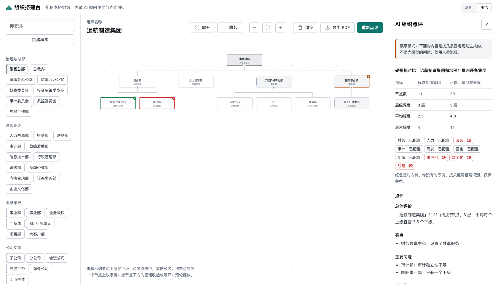

# org-builder · 组织搭建台

[](https://github.com/czd1606391432-hash/org-builder/actions/workflows/tests.yml)
[](LICENSE)


在浏览器里用「积木」拖出一张组织架构图，再让大模型像组织发展（OD）顾问一样逐个节点点评：哪里设计得好、哪里不合理、哪里有风险。

一个网页加一个 Python 后端，都不依赖第三方包。不接大模型也能用来画图、对标和导出，只是没有 AI 点评。



（截图里的组织和对标对象都是虚构的；图中是演示模式的点评结果。）

> Drag-and-drop org chart builder with LLM review. Build an org structure from blocks, get a per-node critique (good / needs work / risk) plus a written assessment, compare hard metrics against a benchmark org, and export to PDF. Single HTML page + a small Python standard-library server; works with any OpenAI-compatible chat API.

## 能做什么

| 功能 | 说明 |
|---|---|
| **积木搭组织** | 左边是 10 类 76 块预设积木（总部职能、事业部、研发、区域组织等），拖到画板的节点上就成为它的下级。也可以自建积木。 |
| **画板操作** | 拖节点到另一个节点上改隶属；双击改名；收起或展开分支；平移、缩放、适应窗口。 |
| **AI 点评** | 给出一篇总体意见（总体评价、亮点、主要问题、风险提示、改进建议），并在图上逐个节点打标记：绿色是亮点，红色是待改进，黄色是高危提示。鼠标移到标记上看理由，点右侧列表里的一条可以定位到节点。 |
| **对标** | 选一个对标组织，比较节点数、层级深度、平均和最大管理幅度、十项关键职能的覆盖情况。这部分在浏览器里直接算，不经过大模型。接了大模型的话，意见文档里会多一节对比分析。 |
| **导出 PDF** | 生成一页包含架构图、意见文档和评判表的打印文档，用浏览器的「打印 → 存为 PDF」保存。 |
| **自动存档** | 画的内容存在浏览器本地，刷新不丢。 |

## 快速开始

需要 Python 3.8 以上，不需要安装任何包。

```bash
git clone https://github.com/czd1606391432-hash/org-builder.git && cd org-builder
```

先用演示模式看一遍完整流程（不需要模型密钥，点评内容按几条固定规则生成，仅作示意）：

```bash
python3 server.py --demo
```

然后在浏览器打开 `http://127.0.0.1:8000`。

## 怎么接大模型

任何兼容 OpenAI `chat/completions` 接口的服务都可以。

```bash
cp .env.example .env
```

在 `.env` 里填三项：

| 变量 | 含义 |
|---|---|
| `LLM_BASE_URL` | 接口地址，写到 `/v1` 这一层即可，程序会自动补上 `/chat/completions`。已经是完整地址的也可以原样写。 |
| `LLM_API_KEY` | 密钥 |
| `LLM_MODEL` | 模型名 |

然后正常启动：

```bash
python3 server.py
```

三项没填齐时，页面其它功能照常可用，点「AI 点评」会提示还没接入。

两个可选项：

- `LLM_EXTRA_TOKENS`：有些模型会先推理再作答，推理内容也占输出长度，正文可能被挤没。程序发现这种情况会自动加大输出长度重试，并记住这个余量；想省掉第一次的重试，可以直接把它设成 `4096`。
- `LLM_CONCURRENCY`：同时最多向模型发几个请求，默认 6。

一次点评会发 1 个「总体意见」请求，外加每 40 个节点 1 个「逐节点评判」请求，并发执行，通常十几秒到几十秒返回。一次最多评 150 个节点，超出的部分不评。

**选模型的建议**：优先用不带推理、响应快的模型。推理型模型也能用，但慢（实测一次约 70 秒），而且偶尔会推理过长把输出长度占满，程序会自动重试。节点数、层级、管理幅度这些硬指标由程序算好后写进提示词，不让模型自己数。

## 怎么加对标数据

对标数据在 [web/benchmarks.json](web/benchmarks.json)。仓库里自带的三个都是**虚构的示例组织**，只用来演示功能。要对标真实的组织，请自己整理数据并核实准确性。

格式：

```json
{
  "companies": [
    {
      "company": "显示在列表里的名称",
      "sector": "分组名（可不写）",
      "root": {
        "name": "集团总部",
        "type": "集团总部",
        "children": [
          {"name": "财务部", "type": "职能部门"},
          {"name": "工程机械事业部", "type": "事业部", "children": [
            {"name": "研发中心", "type": "研发"}
          ]}
        ]
      }
    }
  ]
}
```

- `name` 是组织单元的名称，`type` 是它的类型（随便写，会一起交给模型参考），`children` 是下级。
- 职能覆盖是按名称里的关键词粗略识别的（比如名称含「财务」「资金」就算有财务职能），所以名称尽量写规范。
- 交给大模型的对标树最多 80 个节点；硬指标对比不受这个限制。
- 改完刷新页面即可，不用重启服务。

## 怎么改积木库

预设积木写在 [web/index.html](web/index.html) 里的 `CATS` 数组，格式是 `[分类名, [[积木名, 层级], ...]]`。层级只影响显示样式：`0` 是总部，`1` 是事业部或子公司这类大单元，`2` 是普通部门。

## 接口

页面只用到两个接口，想换成自己的后端也很容易。

`GET /api/health` 返回 `{"llm": true, "demo": false}`。

`POST /api/review`，请求：

```json
{
  "org": {"name": "我的集团"},
  "nodes": [
    {"id": "n0", "name": "集团总部", "type": "集团总部", "depth": 0},
    {"id": "n1", "name": "财务部", "type": "总部职能", "depth": 1}
  ],
  "benchmark": {"company": "对标组织名称", "nodes": [{"name": "总部", "type": "集团总部", "depth": 0}]}
}
```

`nodes` 按从上到下、先根后叶的顺序排列，`depth` 是层级。`benchmark` 可以不传。

响应：

```json
{
  "doc": "## 总体评价\n……",
  "findings": [
    {"id": "n1", "level": "good", "title": "不超过 12 字的结论", "reason": "为什么"}
  ]
}
```

`level` 只有 `good`、`bad`、`risk` 三种。逐节点评判有一部分没成功时，响应里会多一个 `notice` 字段说明结果不完整，页面会显示出来。出错时返回 `{"error": "可以直接给使用者看的原因"}`。

## 部署时注意

- 服务默认只监听本机（`127.0.0.1`）。要给别人用，可以设 `HOST=0.0.0.0`，但请先想清楚下面两条。
- **没有登录和限流**。每次点评都会花模型的钱，直接放到公网上谁都能调。请放在自己的反向代理后面，加上访问控制。
- 组织架构数据只存在使用者自己的浏览器里，服务端不保存；点评时，节点名称会发给你配置的大模型服务。

## 已知局限

- 画板是为鼠标设计的。触屏设备上「拖积木」通常不可用，可以改用「先点选节点，再点积木」的方式添加。节点之间没有完整的键盘导航。
- 「适应窗口」最多缩到 40%，再大的组织要靠拖动和滚轮查看。
- 导出 PDF 依赖浏览器的打印功能，分页和页边距由浏览器决定；架构图是一张图片，很宽的组织打印出来字会偏小。
- 职能覆盖按关键词识别，命名不规范时会漏判或误判，页面上已注明仅供参考。
- 大模型的点评是参考意见，不是结论。同一个组织两次点评的结果可能不同。

## 验证状态

- 后端有 20 个离线测试，大模型用假的替身：请求校验（节点数截断、字段长度、节点 id 白名单）、分批并发与结果合并、模型返回坏 JSON 时的修复与重试、对标参数、接口的各种出错情况。另外用一个本地的假模型接口把整个服务进程跑通过。
- 前端在 Chromium 内核的浏览器里实际操作过：拖积木、改隶属、改名、选对标、点评（演示模式）、定位节点、深色与浅色、窄屏布局。
- **用真实大模型跑过**：接一个 OpenAI 兼容接口的推理型模型，对 30 个节点的示例组织做了「不对标」和「对标」两种点评，都返回了完整的意见文档和逐节点评判，每次约 70 秒；故意放进去的一个问题（内部审计挂在业务部门下面）两次都被点中。只试过这一个模型。
- 导出只核对了生成的打印页内容，没有核对浏览器打印对话框和最终的 PDF 文件。
- Safari 和 Firefox 没有试过。

## 测试

```bash
python3 -m unittest discover -s tests
```

## 目录

```text
server.py              后端入口：网页文件 + 点评接口
org_builder/review.py  点评：校验输入、拼提示词、分批并发、合并结果
org_builder/llm.py     大模型调用：重试、并发闸门、JSON 修复
org_builder/demo.py    演示模式用的固定规则
web/index.html         整个前端（一个文件，不需要构建）
web/benchmarks.json    对标数据（自带三个虚构示例）
tests/                 离线测试
```

## 许可

MIT
